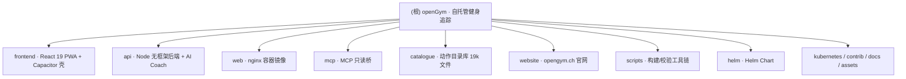

# openGym · CLAUDE.md — AI 上下文文档

> 版本: 2.0 | 最后更新: 2026-10-20 10:16:18 (CST) | 仓库: github.com/DuarteSantos8/openGym @ main (v1.4.1)
> 维护: init-architect（/init-project 增量模式）· 配套索引: [.claude/index.json](./.claude/index.json)

---

## 变更记录 (Changelog)

| 日期 | 版本 | 变更内容 |
|------|------|----------|
| 2026-10-19 之前 | V1 | 上游自带英文版 CLAUDE.md（面向 Claude Code 的仓库指引：布局、命令、架构、贡献纪律） |
| 2026-10-20 | V2.0 | 🆕 init-architect 增量重构:保留 V1 全部事实性内容并融合入标准结构；新增模块结构图（Mermaid）与模块索引；新建 8 个模块级 CLAUDE.md（api / frontend / mcp / catalogue / website / web / scripts / helm）；新建基座级 .claude/index.json v1.0.0 支持断点续扫 |

---

## 项目愿景

**openGym** 是一个**自托管的开源健身房与体重追踪 PWA**（AGPL-3.0-or-later）：计划每周训练、引导式训练记录每一组、追踪体重与进步——数据在你自己的服务器、你自己的文件夹里。没有第三方账号、没有订阅、没有广告、没有遥测。

- **形态**：两个 Docker 容器（`api` + `web`）+ 一个用户自有的 `./data` 目录，一条 `docker compose up` 即跑
- **认证**：Passkey（WebAuthn，Face ID / Touch ID / 指纹）；可按实例开启密码登录；访客模式纯客户端
- **多端**：PWA 可安装到主屏；可选 Capacitor 原生壳打包 Android APK / iOS
- **多语言**：19 种语言（含 RTL 阿拉伯语、繁体中文）
- **可选扩展（默认关闭）**：AI Coach（自有 provider key 的训练计划 AI）、MCP 服务器（LLM 只读访问训练数据）
- **官网**：opengym.ch（`website/` 目录即其源码）；GitHub 为主仓，GitLab 为镜像（fast-forward only，勿直接推 GitLab）

## 架构总览

```
用户浏览器/手机 (PWA / Capacitor 壳)
   │  同源: 静态资源 + /api 反代
   ▼
web 容器 (nginx, 多阶段构建 frontend/ → 静态文件)
   │  /api → BACKEND:PORT
   ▼
api 容器 (Node 22, 无框架 server.js)
   │  JSON 文件存储 (db.json / state-<uid>.json / secret / vapid.json / audit.log / uploads/)
   ▼
./data 目录 (用户自有, 唯一持久化)

旁路: mcp/ (stdio, LLM 客户端拉起, 直接读同一 ./data, 只读)
      api/coach/ (AI Coach, 默认镜像不含, API_TARGET=coach 才有)
```

三条关键设计约束（动代码前必读）：

1. **依赖极简是硬约束**。前端只有 React + Router + Zustand；api/ 运行时依赖仅 3 个（`@simplewebauthn/server`、`undici`、`web-push`）。新增依赖在两侧都极难通过。
2. **Passkey 绑定精确主机名（`RP_ID`）且要求 HTTPS**（localhost 例外）——这塑造了大量 API 与 Settings 代码。动 auth/session/通知前先读 `docs/SELF_HOSTING.md`。
3. **训练逻辑必须是纯函数 + 单测**。"决定你下次举什么 / 回读已记录会话"的任何逻辑都在 `frontend/src/lib/` 里配同目录 `*.test.js`，不允许只靠点页面验证（progression 引擎曾出过两个只有测试能抓到的 bug）。

## 模块结构图



## 模块索引

| 路径 | 职责 | 技术栈 | 规模 | 本地文档 |
|------|------|--------|------|----------|
| `frontend/` | React 19 PWA：全部 UI + 训练域逻辑（lib/ 纯函数）+ Zustand 状态 + i18n + Capacitor Android/iOS 原生壳 | React 19 / Vite 8 / Zustand 5 / Vitest 4 / Capacitor 7 | src 651 文件 + android + ios | [CLAUDE.md](./frontend/CLAUDE.md) |
| `api/` | 后端：单文件无框架 Node 服务器（passkey 认证 + JSON 文件存储 + Web Push + 媒体上传）+ 可选 AI Coach 子系统 | Node 22, `node:test` | 133 文件（test/ 71） | [CLAUDE.md](./api/CLAUDE.md) |
| `web/` | web 容器：多阶段 Dockerfile（构建 frontend → nginx 服务）+ nginx 配置模板（启动时按 env 渲染） | Docker / nginx | 3 文件 | [CLAUDE.md](./web/CLAUDE.md) |
| `mcp/` | MCP (Model Context Protocol) 只读 stdio 桥：LLM 客户端直读 `./data` 的 9 个工具，复用 frontend 纯函数 | MCP SDK / zod / Vitest | 12 文件 | [CLAUDE.md](./mcp/CLAUDE.md) |
| `catalogue/` | 动作目录库：6,554 个动作 JSON（英）+ i18n 翻译 + 授权媒体（webp/mp4，勿动）+ 生成的 browse 页 | 纯 JSON + 校验脚本 | 19,693 文件 | [CLAUDE.md](./catalogue/CLAUDE.md) |
| `website/` | opengym.ch 官网：手写 HTML/CSS/JS 无构建；`api.html` 为生成物 | 静态站 | 16 文件 | [CLAUDE.md](./website/CLAUDE.md) |
| `scripts/` | 仓库级工具链：catalogue 构建/校验、coach 资产构建、API 文档生成、媒体打包、i18n 名称源 | Node mjs / Python | 33 文件 | [CLAUDE.md](./scripts/CLAUDE.md) |
| `helm/` | Helm Chart（application，chart 0.2.1 / app 1.4.1）：K8s 部署模板全套 | Helm | 16 文件 | [CLAUDE.md](./helm/CLAUDE.md) |
| `kubernetes/` | 裸 K8s 示例 manifests（deployment/service/pvc/httproute/kustomization） | YAML | 6 文件 | —（见 `docs/SELF_HOSTING_KUBERNETES.md`） |
| `contrib/nix/` | Nix 打包（flake：api / frontend / mcp / tests） | Nix | 8 文件 | —（见 `docs/NIX.md`） |
| `docs/` | 全部指南：自托管/HTTPS/K8s/移动端/AI Coach/数据导入/API + `docs/dev/` 设计笔记 + 架构图 | Markdown | 23 文件 | —（入口 `docs/README.md`） |
| `assets/` | 仓库级图片：banner、五张截图、social.jpg | PNG/SVG | 9 文件 | — |

**运行时目录（gitignored，勿提交）**：`data/`（用户/凭据/状态/密钥——整个实例的备份就是它）、`media/`（v1.4.0 前的旧动作媒体下载）、`frontend/dist/`、`node_modules/`、`.env`。

## 运行与开发

```bash
# ── 本地全栈（api + web，预构建或源码构建）──────────────────────
cp .env.example .env
docker compose up -d --build          # http://localhost:8080

# ── 前端开发服务器（热更新，/api 代理到 :3000）─────────────────
cd frontend && npm install && npm run dev

# ── 测试（三套各自独立）──────────────────────────────────────
cd frontend && npm test               # vitest run（训练逻辑: progression/1RM/会话回读）
cd api && npm test                    # node --test test/*.test.js
cd mcp && npm test                    # vitest run

# 单文件 / 单用例
cd frontend && npx vitest run src/lib/progression.test.js
cd frontend && npx vitest run -t "some test name"

# ── 构建 ─────────────────────────────────────────────────────
cd frontend && npm run build          # 生产构建（静态文件）
cd frontend && npm run build:mobile   # 移动端: VITE_MOBILE=1 + stage-media + cap sync + 检查

# ── 目录库（Node 20+）───────────────────────────────────────
node scripts/catalogue/validate.mjs   # 校验每个条目（PR 上由 Catalogue check 自动跑）
node scripts/catalogue/build.mjs      # 重新生成应用数据文件与 browse/

# ── AI Coach 镜像（可选，~300MB 额外）────────────────────────
API_TARGET=coach docker compose up --build api
```

无 linter / formatter / TypeScript——手工对齐现有风格。CI 用 Node 22（与 `web/Dockerfile` / `api/Dockerfile` 的 `node:22-alpine` 一致）。

### CI/CD 全景

| 环节 | 文件 | 说明 |
|------|------|------|
| PR/主干测试 | `.github/workflows/test.yml` | frontend（test + build + locale 双检 + 疲劳单调性探针）+ mcp + api（两个镜像 target 都构建并启动） |
| 目录库校验 | `.github/workflows/catalogue.yml` | PR 上校验 catalogue 改动并报错到具体文件字段 |
| 镜像发布 | `.github/workflows/docker-publish.yml` | ghcr.io/duartesantos8/opengym-{api,web}（amd64+arm64） |
| 镜像同步 | `.github/workflows/mirror.yml` | 推 main 与 v* tag 到 GitLab 镜像（**GitLab 侧只 fast-forward，勿直接推/合并**） |
| 官网发布 | `.github/workflows/pages.yml` | website/ → Pages |
| CLA | `.github/workflows/cla.yml` / `cla-issue.yml` | 贡献者协议签署 |
| 发布产物 | `.gitlab-ci.yml`（GitLab 侧） | 签名 Android APK、多架构镜像、SBOM |
| Gitea 镜像 | `.gitea/workflows/` | 同 test + docker-publish 的 Gitea 版 |

## 测试策略

- **frontend**（Vitest 4 + happy-dom/linkedom）：`src/lib/*.test.js` 覆盖全部训练域纯函数；`src/views/*.test.jsx` 按屏幕行为分文件（Settings 十几个维度各一个）；`src/store/useStore.*.test.jsx` 覆盖状态机与同步。另有 `npm run test:fatigue-probe`（约 10.8 万次比较的单调性属性探针，只在 CI 跑）。
- **api**（`node:test`，71 个测试文件）：routes/openapi 一致性、各 server 子系统（passkeys/password/media/push/pairing/admin/data-rev…）、coach 子系统（adapters/pipeline/prompts/jobs）、Dockerfile COPY 完整性（`dockerfile-copy.test.js`）。
- **mcp**（Vitest，58 用例）：用 `frontend/src/lib/demoSeed.js` 同一确定性夹具固定 JSON 形状；`vi.useFakeTimers` 钉死"今天"。
- **catalogue**：无运行时测试，靠 `scripts/catalogue/validate.mjs` + PR check。
- **Android**：`frontend/android/app/src/test/`（RestTone 等少量 JUnit）。

## 编码规范（源自 CONTRIBUTING.md 与仓库惯例）

1. **依赖极简**：见"架构总览"约束 1。前端/后端/MCP 三处新依赖都要先过这一关。
2. **训练逻辑改动必须配 `src/lib` 单测**（progression、1RM、session read-back 类），不接受手动点验。
3. **不提交 `media/`、`data/`**（gitignored）。
4. **catalogue 媒体不是开放的**：`catalogue/media/` 图片/动画来自 Gym visual 授权，**勿增删改、勿复制到别处、勿喂给 AI 工具**；对动作画面的修正走 issue。
5. **catalogue id 永不改/不复用/不删除**（workouts/routines/records 都存 id）；重复靠改进入目而非删除。
6. **api 新增路由**：在 `api/server.js` 的 `routes` 对象加 `'METHOD /path'` 键，**同时**补 `api/openapi.yaml`（有 `openapi-routes.test.js` 强制一致），再跑 `node scripts/build-api-docs.mjs` 重生成 `website/api.html`（该文件勿手编）。
7. **无框架后端**：`api/` 不引入 Express/Fastify 类框架，路由分发就是那个 `routes` 对象。
8. 文案风格：动作描述用第二人称祈使句、无 em dash；名字小写、器材开头。

## AI 使用指引

1. **先看模块文档**：动哪个模块先读其 CLAUDE.md（见模块索引），再读该模块 README/文档。
2. **部署/自托管问题先读 `docs/SELF_HOSTING.md`**：env 变量契约（`RP_ID`/`ORIGIN`/`PORT`/`SESSION_DAYS`/`ADMIN_UIDS`/`INVITE_ONLY`/`ALLOW_GUEST`/`AUDIT_*`/`VAPID_SUBJECT` 等）是真实部署依赖的合同。
3. **改 catalogue 只动 JSON 与 i18n**，媒体勿碰；改完跑 `validate.mjs` + `build.mjs`。
4. **GitLab 是镜像不是工作区**；`.spec-workflow/` 是规格流程模板，非产品代码。
5. **数据安全红线**：`data/secret`（会话签名）、`data/db.json`（凭据）、`data/coach.json`（加密的 provider 凭据）——任何改动不得将其暴露给 Coach 运行时（`api/coach/adapters/spawn.js` 的降权是 fail-closed 控制点）。
6. **索引续跑**：本轮扫描元数据与缺口在 [.claude/index.json](./.claude/index.json)（v1.0.0），下次 /init-project 优先补齐缺口清单。

## 相关文件

- [README.md](./README.md) — 项目主页文档（特性全景、快速开始、同步机制）
- [CONTRIBUTING.md](./CONTRIBUTING.md) — 贡献纪律（依赖约束、测试要求）
- [CHANGELOG.md](./CHANGELOG.md) / [ROADMAP.md](./ROADMAP.md) — 版本史与路线图
- [docs/README.md](./docs/README.md) — 全部指南索引
- [docs/diagrams/architecture.mmd](./docs/diagrams/architecture.mmd) — 官方架构图源码
- [.env.example](./.env.example) — 全部环境变量合同（带完整注释）
- [.claude/index.json](./.claude/index.json) — 本轮扫描索引（gitignored，本地）
