# 沐禾健身（Muhe Fit）· CLAUDE.md — AI 上下文文档

> 版本: 3.0 | 最后更新: 2026-10-27 20:52:44 (CST)
> 仓库: **fork** = github.com/changzhi777/openGym @ `claude/nostalgic-austin-94093b`（HEAD 2e6341af，v1.4.1-41）· 上游 = github.com/DuarteSantos8/openGym
> 维护: init-architect（/init-project 增量模式）· 配套索引: [.claude/index.json](./.claude/index.json) · fork 台账: [FORK.md](./FORK.md)

---

## 变更记录 (Changelog)

| 日期 | 版本 | 变更内容 |
|------|------|----------|
| 2026-10-19 之前 | V1 | 上游自带英文版 CLAUDE.md（面向 Claude Code 的仓库指引：布局、命令、架构、贡献纪律） |
| 2026-10-20 | V2.0 | 🆕 init-architect 增量重构:保留 V1 全部事实性内容并融合入标准结构；新增模块结构图（Mermaid）与模块索引；新建 8 个模块级 CLAUDE.md（api / frontend / mcp / catalogue / website / web / scripts / helm）；新建基座级 .claude/index.json v1.0.0 支持断点续扫 |
| 2026-10-27 | V3.0 | 🆕 中文品牌改造 + Go 后端轮:init-architect 第三轮增量扫描（基点 HEAD 2e6341af，较上游 v1.4.1 领先 41 提交）。① 项目定名**沐禾健身 / Muhe Fit**（openGym 中文品牌改造 fork，双远端 origin/upstream，fork 台账 FORK.md）；② 🆕 新模块 **backend-go/**（Go 重写栈 P0–P6，详见其 CLAUDE.md）+ 9 个模块 CLAUDE.md 全部加导航面包屑；③ frontend 新增管理后台 views/admin/（AdminShell + 三角色 + step-up）与 lib/admin/；④ api 契约冻结：openapi.yaml 新增 SaaS 后台端点，Node 侧 8 端点挂 501 stub，测试套件支持 MUHE_GO 双跑 Go 栈（74 文件）；⑤ catalogue 动作说明全量中文化（5,632 条）+ scripts 新增 translate-zh / deploy-ct151 / test-all 三脚本；⑥ 生产实例 = PVE CT 151 @ 10.10.10.151（deploy-ct151.sh）；⑦ 测试门口径钉死 Node 22 + TZ=UTC（./scripts/test-all.sh，基线 api 605 / frontend 5060 / mcp 95 全绿） |

---

## 项目愿景

**沐禾健身（Muhe Fit）** 是 **openGym 的中文品牌改造 fork**——一个自托管的开源健身房与体重追踪 PWA（AGPL-3.0-or-later）：计划每周训练、引导式训练记录每一组、追踪体重与进步——数据在你自己的服务器、你自己的文件夹里。没有第三方账号、没有订阅、没有广告、没有遥测。

- **形态**：两个 Docker 容器（`api` + `web`）+ 一个用户自有的 `./data` 目录，一条 `docker compose up` 即跑；fork 另有 **Go 版后端栈** `backend-go/`（Gin + PG + Redis，与 Node 栈并存，灰度切换方案已演练）
- **认证**：Passkey（WebAuthn，Face ID / Touch ID / 指纹）；可按实例开启密码登录；访客模式纯客户端
- **多端**：PWA 可安装到主屏；Capacitor 原生壳打包 Android APK（包名 **com.muhe.fit**）/ iOS
- **多语言**：19 种语言（含 RTL 阿拉伯语、繁体中文）；fork 已做 zh 术语规范化 + 动作说明全量中文化
- **可选扩展（默认关闭）**：AI Coach（自有 provider key 的训练计划 AI）、MCP 服务器（LLM 只读访问训练数据）
- **上游关系（FORK.md 为准）**：`origin` = changzhi777/openGym（本 fork），`upstream` = DuarteSantos8/openGym；保留完整 git 历史，定期 merge 吸收上游 release（约两周一个版），fork 改动尽量收敛在独立分支/独立文件以减小冲突面；AGPL §13 网络服务源码义务由 FORK.md 承接

## 架构总览

```
用户浏览器/手机 (PWA / Capacitor 壳 com.muhe.fit)
   │  同源: 静态资源 + /api 反代
   ▼
web 容器 (nginx, 多阶段构建 frontend/ → 静态文件)
   │  /api → BACKEND:PORT
   ▼
api 容器 (Node 22, 无框架 server.js)          ┄┄ 灰度切换线 ┄┄
   │  JSON 文件存储 (db.json / state-<uid>.json / secret / vapid.json / audit.log / uploads/)
   ▼                                             ▼
./data 目录 (用户自有, 唯一持久化)      backend-go/ (Go 重写栈, Gin+PG+Redis,
                                        迁移内嵌; muhemigrate 双向迁移; gray-switch.sh 切换)

旁路: mcp/ (stdio, LLM 客户端拉起, 直接读同一 ./data, 只读)
      api/coach/ (AI Coach, 默认镜像不含, API_TARGET=coach 才有)
```

**四条关键设计约束（动代码前必读）**：

1. **Node 侧依赖极简是硬约束**。前端只有 React + Router + Zustand；api/ 运行时依赖仅 3 个（`@simplewebauthn/server`、`undici`、`web-push`）。例外：**backend-go 是 fork 新栈**，允许 Gin/pgx/go-redis 等成熟能力，但同样克制（go.mod 直接依赖仅 7 个）。
2. **Passkey 绑定精确主机名（`RP_ID`）且要求 HTTPS**（localhost 例外）——这塑造了大量 API 与 Settings 代码。动 auth/session/通知前先读 `docs/SELF_HOSTING.md`。
3. **训练逻辑必须是纯函数 + 单测**。"决定你下次举什么 / 回读已记录会话"的任何逻辑都在 `frontend/src/lib/` 里配同目录 `*.test.js`，不允许只靠点页面验证（progression 引擎曾出过两个只有测试能抓到的 bug）。
4. **契约冻结 + 台账纪律（fork 新增）**。任何新端点先改 `api/openapi.yaml`（唯一契约源，title 已是"沐禾健身 API"）→ Node 侧可挂 501 stub（`notYetGo`）→ Go 侧实现；每次成块改动在 [FORK.md](./FORK.md) §5 追加台账（日期/提交/内容）。

## 模块结构图

```mermaid
graph TD
    ROOT["(根) 沐禾健身 Muhe Fit · openGym 中文品牌 fork"] --> FE["frontend · React 19 PWA + Capacitor 壳"]
    ROOT --> API["api · Node 无框架后端 + AI Coach"]
    ROOT --> GO["backend-go · 🆕 Go 重写栈 P0–P6"]
    ROOT --> WEB["web · nginx 容器镜像"]
    ROOT --> MCP["mcp · MCP 只读桥"]
    ROOT --> CAT["catalogue · 动作目录库 19k 文件"]
    ROOT --> SITE["website · 官网"]
    ROOT --> SCRIPTS["scripts · 构建/校验/部署/测试工具链"]
    ROOT --> HELM["helm · Helm Chart"]
    ROOT --> DEPLOY["kubernetes / contrib / docs / assets"]

    click FE "./frontend/CLAUDE.md" "查看 frontend 模块文档"
    click API "./api/CLAUDE.md" "查看 api 模块文档"
    click GO "./backend-go/CLAUDE.md" "查看 backend-go 模块文档"
    click WEB "./web/CLAUDE.md" "查看 web 模块文档"
    click MCP "./mcp/CLAUDE.md" "查看 mcp 模块文档"
    click CAT "./catalogue/CLAUDE.md" "查看 catalogue 模块文档"
    click SITE "./website/CLAUDE.md" "查看 website 模块文档"
    click SCRIPTS "./scripts/CLAUDE.md" "查看 scripts 模块文档"
    click HELM "./helm/CLAUDE.md" "查看 helm 模块文档"
```



## 模块索引

| 路径 | 职责 | 技术栈 | 规模 | 本地文档 |
|------|------|--------|------|----------|
| `frontend/` | React 19 PWA（**沐禾健身**品牌，appId com.muhe.fit）：全部 UI + 训练域纯函数 + Zustand + i18n + 🆕 管理后台 views/admin/（三角色 + step-up）+ Capacitor 壳 | React 19 / Vite 8 / Zustand 5 / Vitest 4 / Capacitor 7 | src ~663 文件 + android + ios | [CLAUDE.md](./frontend/CLAUDE.md) |
| `api/` | Node 22 后端：passkey + JSON 存储 + Push + 媒体 + AI Coach；🆕 openapi.yaml 契约冻结（title 沐禾健身 API），fork 新增 8 个 SaaS 端点挂 501 stub；测试套件支持 MUHE_GO 双跑 Go 栈 | Node 22, `node:test` | ~136 文件（test/ 74） | [CLAUDE.md](./api/CLAUDE.md) |
| `backend-go/` | 🆕 **Go 重写栈**（fork SaaS 主战场）：Gin + PG(迁移内嵌) + Redis；cmd/api + cmd/muhemigrate 双向迁移器 + internal 10 包；P0–P6 完成（含 gray-switch.sh 灰度演练）。internal/data 曾被 .gitignore 裸 `data/` 规则吞包，2026-10-28 已修复（见其文档） | Go 1.26 / Gin / pgx / go-redis | 44 文件 | [CLAUDE.md](./backend-go/CLAUDE.md) |
| `web/` | web 容器：多阶段 Dockerfile（构建 frontend → nginx 服务）+ nginx 配置模板（启动时按 env 渲染） | Docker / nginx | 3 文件 | [CLAUDE.md](./web/CLAUDE.md) |
| `mcp/` | MCP 只读 stdio 桥：LLM 客户端直读 `./data` 的 9 个工具，复用 frontend 纯函数（包名 muhe-mcp） | MCP SDK / zod / Vitest | 12 文件 | [CLAUDE.md](./mcp/CLAUDE.md) |
| `catalogue/` | 动作目录库：6,554 个动作 JSON + i18n 翻译（🆕 **zh 说明全量中文化 5,632 条**）+ 授权媒体（勿动）+ 生成的 browse 页 | 纯 JSON + 校验脚本 | 19,693 文件 | [CLAUDE.md](./catalogue/CLAUDE.md) |
| `website/` | 项目官网：手写 HTML/CSS/JS 无构建；`api.html` 为生成物（已随"沐禾健身 API"契约再生） | 静态站 | 16 文件 | [CLAUDE.md](./website/CLAUDE.md) |
| `scripts/` | 仓库级工具链：catalogue 构建/校验/🆕批量中文化、coach 资产、API 文档、媒体打包、🆕 deploy-ct151 部署、🆕 test-all 测试门 | Node mjs / Python / Bash | 36 文件 | [CLAUDE.md](./scripts/CLAUDE.md) |
| `helm/` | Helm Chart（application，chart 0.2.1 / app 1.4.1）：K8s 部署模板全套（上游镜像） | Helm | 16 文件 | [CLAUDE.md](./helm/CLAUDE.md) |
| `kubernetes/` | 裸 K8s 示例 manifests | YAML | 6 文件 | —（见 `docs/SELF_HOSTING_KUBERNETES.md`） |
| `contrib/nix/` | Nix 打包（flake：api / frontend / mcp / tests） | Nix | 8 文件 | —（见 `docs/NIX.md`） |
| `docs/` | 全部指南 + `docs/dev/` 设计笔记 + 🆕 admin-ui-design.md / i18n-terminology-audit.md | Markdown | 25+ 文件 | —（入口 `docs/README.md`） |
| `assets/` | 仓库级图片：banner、五张截图、social.jpg | PNG/SVG | 9 文件 | — |

**运行时目录（gitignored，勿提交）**：`data/`（用户/凭据/状态/密钥——整个实例的备份就是它）、`media/`（旧动作媒体下载）、`frontend/dist/`、`node_modules/`、`.env`；fork 本地方案目录 `.zcf/`（backend-go 方案文档所在）。

## 运行与开发

```bash
# ── fork 测试门（一条命令三套全跑；口径见 FORK.md §6）──────────
./scripts/test-all.sh                  # Node 22 + TZ=UTC，api/frontend/mcp 三套
./scripts/test-all.sh frontend         # 或单跑一套

# ── 本地全栈（api + web，预构建或源码构建）──────────────────────
cp .env.example .env
docker compose up -d --build          # http://localhost:8080

# ── 本机轻量全栈（2026-10-21 验证，FORK.md §7）──────────────────
cd api && npm ci
PORT=3100 DATA_DIR=../data RP_ID=localhost ORIGIN=http://localhost:5173 \
  SESSION_DAYS=90 TRUST_PROXY=1 node server.js
cd frontend && npm ci && API_TARGET=http://127.0.0.1:3100 npm run dev

# ── 前端开发服务器（热更新，/api 代理到 :3000）─────────────────
cd frontend && npm install && npm run dev

# ── 各模块测试 ────────────────────────────────────────────────
cd frontend && npm test               # vitest run（训练逻辑: progression/1RM/会话回读）
cd api && npm test                    # node --test test/*.test.js（74 文件）
cd mcp && npm test                    # vitest run
cd backend-go && go test ./...        # Go 侧（暂无 *_test.go；主测法见下）
MUHE_GO=1 (cd api && PG+Redis 就绪) npm test   # Node 套件双跑 Go 栈（compose.go.yml 起依赖）

# ── Go 栈本地起停 ─────────────────────────────────────────────
cd backend-go
docker compose -f compose.go.yml up -d --build   # pg16 + redis7 + api(3110)
./scripts/gray-switch.sh migrate|switch|rollback # P6 灰度切换/回滚

# ── 构建 ─────────────────────────────────────────────────────
cd frontend && npm run build          # web 生产构建
cd frontend && npm run build:mobile   # 移动端: VITE_MOBILE=1 + stage-media + cap sync
#   ⚠️ APK 必须 build:mobile（普通 build 的 APK 动画全黑）；⚠️ 必须 JDK 21
cd android && JAVA_HOME=$(/usr/libexec/java_home -v 21) ./gradlew assembleDebug

# ── 目录库 ───────────────────────────────────────────────────
node scripts/catalogue/validate.mjs   # 校验每个条目
node scripts/catalogue/build.mjs      # 重新生成应用数据文件与 browse/

# ── 部署（生产 = PVE CT 151 @ 10.10.10.151，回内网运行）────────
./scripts/deploy-ct151.sh             # 全量（rsync + API + 前端 + nginx，幂等）
./scripts/deploy-ct151.sh --api-only  # 只更 API

# ── AI Coach 镜像（可选）──────────────────────────────────────
API_TARGET=coach docker compose up --build api
```

无 linter / formatter / TypeScript——手工对齐现有风格。测试门钉死 **Node 22 + TZ=UTC**（Node ≥24 的实验性全局 localStorage 与 UTC+8 时区都会造成大面积假红，原因实测记录在 `scripts/test-all.sh` 头注释与 FORK.md §6）。基线（2026-10-21）：**api 605 / frontend 5060 / mcp 95 全绿**。

### CI/CD 全景

| 环节 | 文件 | 说明 |
|------|------|------|
| PR/主干测试 | `.github/workflows/test.yml` | frontend（test + build + locale 双检 + 疲劳探针）+ mcp + api（两个镜像 target 都构建并启动）；Node 22 恰好避开 fork 已知的两坑 |
| 目录库校验 | `.github/workflows/catalogue.yml` | PR 上校验 catalogue 改动并报错到具体文件字段 |
| 镜像发布 | `.github/workflows/docker-publish.yml` | ghcr.io/duartesantos8/opengym-{api,web}（上游镜像；fork 生产不走它） |
| 镜像同步 | `.github/workflows/mirror.yml` | 推 main 与 v* tag 到 GitLab 镜像（上游机制，fork 勿直接推 GitLab） |
| fork 部署 | `scripts/deploy-ct151.sh` | 生产 PVE CT 151（Node 22 + systemd + nginx）；Go 栈切换走 `backend-go/scripts/gray-switch.sh` |
| fork 台账 | [FORK.md](./FORK.md) | 与上游关系 / AGPL 义务 / 媒体版权边界 / 改动记录 / 测试口径 |

## 测试策略

- **frontend**（Vitest 4 + happy-dom/linkedom）：`src/lib/*.test.js` 覆盖全部训练域纯函数；`src/views/*.test.jsx` 按屏幕行为分文件；`src/store/useStore.*.test.jsx` 覆盖状态机与同步。fork 新增 `vitest.config.mjs`（fork-only，不进 vite.config.js 以避上游冲突）修 Node≥24 localStorage 遮蔽。另有 `test:fatigue-probe` 属性探针。
- **api**（`node:test`，74 个测试文件）：routes/openapi 一致性、各 server 子系统、coach 子系统、Dockerfile COPY 完整性。**fork 扩展：26 个文件带 MUHE_TEST 启动分支，`MUHE_GO=1` 时同一批用例拉起 Go 栈双跑**——backend-go 的主测法。
- **backend-go**：`internal/data/stamps_test.go` 一处纯函数保护网（Node sync-stamps 用例翻译）；正确性主由 ① Node 套件双跑 ② muhemigrate round-trip 全等验收（gray-switch.sh migrate 内置）保证。
- **mcp**（Vitest）：demoSeed 确定性夹具 + fake timers。
- **catalogue**：无运行时测试，靠 `validate.mjs` + PR check。
- **已知偶发**（非改动引起，重跑即绿）：全量并行跑时 `useStore.tabs-owner` / `adopt-hold` 偶红（多标签 storage 时序）。

## 编码规范（源自 CONTRIBUTING.md、FORK.md 与仓库惯例）

1. **依赖极简**：Node 侧三条线（frontend/api/mcp）新依赖都要先过这一关；backend-go 例外规则见约束 1。
2. **训练逻辑改动必须配 `src/lib` 单测**，不接受手动点验。
3. **不提交 `media/`、`data/`**（gitignored）。
4. **catalogue 媒体不是开放的**：`catalogue/media/` 来自 Gym visual 授权（**非 AGPL**，边界见 FORK.md §3）——勿增删改、勿外传、勿喂 AI 工具；**fork 一旦商用必须先取得自有授权或整体替换素材**。
5. **catalogue id 永不改/不复用/不删除**；重复靠改进入目而非删除。
6. **契约冻结（fork 纪律）**：新端点先改 `api/openapi.yaml`（唯一契约源）→ `node scripts/build-api-docs.mjs` 重生成 `website/api.html`（勿手编）→ Node 侧未实现就挂 `notYetGo` 501 → Go 侧在 backend-go 实现；改 `server.js` 路由表须同步 `api/Dockerfile` COPY 行（有测试盯着）。
7. **FORK.md 台账纪律**：成块改动（品牌、新栈、批量数据）在 FORK.md §5 追加一行（日期/分支/提交/内容）；对外提供网络服务时该文件即 AGPL §13 源码可用性入口之一。
8. **无框架后端（Node 侧）**：`api/` 不引入 Express/Fastify 类框架，路由分发就是那个 `routes` 对象；Go 侧统一 Gin，不引入第二套框架。
9. **品牌单点**：中文品牌词经 `frontend/src/lib/i18n-core.js` 的 `BRAND` 渲染层单点替换（locale 键零改动）；文档目录保护 `Documents/MuheFit`。
10. 文案风格：动作描述第二人称祈使句、无 em dash；名字小写、器材开头；中文术语以 `frontend/docs/i18n-terminology-audit.md` 口径为准。

## AI 使用指引

1. **先看模块文档**：动哪个模块先读其 CLAUDE.md（见模块索引），再读该模块 README/文档；**fork 改动先读 [FORK.md](./FORK.md)**。
2. **部署/自托管问题先读 `docs/SELF_HOSTING.md`**：env 变量契约（`RP_ID`/`ORIGIN`/`PORT`/`SESSION_DAYS`/`ADMIN_UIDS`/`INVITE_ONLY`/`ALLOW_GUEST`/`AUDIT_*`/`VAPID_SUBJECT` 等）是真实部署依赖的合同；fork 生产运维另有 `scripts/deploy-ct151.sh` 与 gray-switch 流程。
3. **改 catalogue 只动 JSON 与 i18n**，媒体勿碰；改完跑 `validate.mjs` + `build.mjs`；批量中文翻译走 `scripts/catalogue/translate-zh.mjs`（断点续跑，写回 zh.json 后必须 build）。
4. **上游同步**：`upstream` 只用于 merge 进来；不直接推上游；GitLab 是上游的镜像，fork 勿碰。
5. **数据安全红线**：`data/secret`（会话签名，**灰度两栈必须同钥**）、`data/db.json`（凭据）、`data/coach.json`（加密 provider 凭据）——不得暴露给 Coach 运行时（`api/coach/adapters/spawn.js` 降权是 fail-closed 控制点）。
6. **backend-go 现状**：P0–P6 完成；`internal/data` 曾被 .gitignore 裸 `data/` 规则静默吞包（`git add` 无报错、全历史零踪迹的教训），2026-10-28 已修复并锚根 `/data/`（随修复提交恢复入库）——细节见 [backend-go/CLAUDE.md](./backend-go/CLAUDE.md)。
7. **索引续跑**：本轮扫描元数据与缺口在 [.claude/index.json](./.claude/index.json)（v1.1.0），下次 /init-project 优先补齐缺口清单。

## 相关文件

- [FORK.md](./FORK.md) — **fork 台账**（上游关系 / AGPL 义务 / 媒体版权 / 改动记录 / 测试口径 / APK 构建坑）
- [README.md](./README.md) — 项目主页文档（特性全景、快速开始、同步机制）
- [CONTRIBUTING.md](./CONTRIBUTING.md) — 上游贡献纪律（依赖约束、测试要求）
- [CHANGELOG.md](./CHANGELOG.md) / [ROADMAP.md](./ROADMAP.md) — 上游版本史与路线图
- [docs/README.md](./docs/README.md) — 全部指南索引
- [docs/diagrams/architecture.mmd](./docs/diagrams/architecture.mmd) — 官方架构图源码
- [.env.example](./.env.example) — 全部环境变量合同（带完整注释）
- [package.json](./package.json) — 根级（仅 js-yaml devDep，CI/脚本用）
- [.claude/index.json](./.claude/index.json) — 本轮扫描索引（v1.1.0，gitignored，本地）
