# 沐禾健身（Muhe Fit）· CLAUDE.md — AI 上下文文档

> 版本: 3.2 | 最后更新: 2026-11-11 (CST)
> 仓库: **fork 主仓 = cnb.cool/qingmu2026/muhe-fit**（CNB 私有，沐禾健康组织，2026-10-28 全量迁移）· GitHub 镜像 = changzhi777/openGym · 上游 = DuarteSantos8/openGym
> 维护: init-architect（/init-project 增量模式）· 配套索引: [.claude/index.json](./.claude/index.json) · fork 台账: [FORK.md](./FORK.md)

---

## 变更记录 (Changelog)

| 日期 | 版本 | 变更内容 |
|------|------|----------|
| 2026-10-19 之前 | V1 | 上游自带英文版 CLAUDE.md（面向 Claude Code 的仓库指引：布局、命令、架构、贡献纪律） |
| 2026-10-20 | V2.0 | 🆕 init-architect 增量重构:保留 V1 全部事实性内容并融合入标准结构；新增模块结构图（Mermaid）与模块索引；新建 8 个模块级 CLAUDE.md（api / frontend / mcp / catalogue / website / web / scripts / helm）；新建基座级 .claude/index.json v1.0.0 支持断点续扫 |
| 2026-10-27 | V3.0 | 🆕 中文品牌改造 + Go 后端轮:init-architect 第三轮增量扫描（基点 HEAD 2e6341af，较上游 v1.4.1 领先 41 提交）。① 项目定名**沐禾健身 / Muhe Fit**（openGym 中文品牌改造 fork，双远端 origin/upstream，fork 台账 FORK.md）；② 🆕 新模块 **backend-go/**（Go 重写栈 P0–P6，详见其 CLAUDE.md）+ 9 个模块 CLAUDE.md 全部加导航面包屑；③ frontend 新增管理后台 views/admin/（AdminShell + 三角色 + step-up）与 lib/admin/；④ api 契约冻结：openapi.yaml 新增 SaaS 后台端点，Node 侧 8 端点挂 501 stub，测试套件支持 MUHE_GO 双跑 Go 栈（74 文件）；⑤ catalogue 动作说明全量中文化（5,632 条）+ scripts 新增 translate-zh / deploy-ct151 / test-all 三脚本；⑥ 生产实例 = PVE CT 151 @ 10.10.10.151（deploy-ct151.sh）；⑦ 测试门口径钉死 Node 22 + TZ=UTC（./scripts/test-all.sh，基线 api 605 / frontend 5060 / mcp 95 全绿） |
| 2026-11-10 | V3.1 | 🆕 **AI-Native 重构方案落地（规划轮，代码未动）**:init-architect 第四轮增量扫描（方案全文：《沐禾健身-AINative重构方案.md》，2026-11-10）。① 定调 Coach 升级方向——从"批处理生成器"升级为"带工具、带记忆、可对话的 Agent"，四层目标 L1 对话入口 / L2 Agent 内核（tool-loop）/ L3 记忆层 / L4 计量层，分 P0–P5 实施；② **MCP 定位升级规划**：工具层从"旁路桥"提升为"Coach 内核工具运行时"（同一注册表、两个消费者）；③ 受影响四模块（api / mcp / frontend / backend-go）CLAUDE.md 各增"AI-Native 重构规划"小节（现状 vs 规划严格分开）；④ 编码规范补 AI 三红线（validate 安全边界不动 / agent 框架不进 / 未经确认写入为零）；⑤ 顺带修正文档漂移：Node 侧 501 stub 实为 21 键（认证重构新增 captcha/sms/wechat/bind-phone 7 端点）、MUHE_TEST 双跑文件实为 28、backend-go 迁移实达 0012（16 internal 包）；⑥ 补记 **2026-10-29 认证重构**：Go 栈（生产）passkey/密码/配对退役 → 手机号+短信验证码 / 微信扫码；⑦ 索引 .claude/index.json 升 v1.2.0（缺口=P0–P5 待实施） |
| 2026-11-11 | V3.2 | 🆕 **AI-Native 重构六批次实施完毕（实施后刷新轮，只改文档与索引，零源代码改动）**:init-architect 第五轮增量扫描；事实源 = [FORK.md](./FORK.md) §5 台账批次 1–6 六行，全部数字经实际文件抽查验证。① 方案（`.zcf/沐禾健身-AINative重构方案-v2.md`，15 裁决问答轮定稿）六批次全落地：**批 1** 契约先行（openapi 对话面 7 操作/6 路径 + 3 schema，api.html 103→107 端点）→ **批 2** Go Agent 内核（`internal/llm` + `internal/agent`：tool-loop/审核链/七端点真实现 + onerm golden 4480 案 JS↔Go 等价验收 + 0013 五表迁移 + 修 0007 迁移幂等 bug + Node 分发器补 5 条 {id} 映射）→ **批 3** WeKnora 知识集成（`internal/weknora` D14 强制 kbIDs + `compose.weknora.yml` + ETL 媒体永不进管道）→ **批 4** 对话前端（`views/home-ai/CoachChatHome` + `/coach-ai` 路由 + `lib/api-chat.js`/`coach-chat.js` 30 测试）→ **批 5** 计量 admin 化（usage-overview + limits + Overview AI 用量卡）→ **批 6** 治理台收官（agent-config 热生效 + `AgentConfig.jsx`「AI 治理」页 + reviewer 每回合热组装 + get_bodyweight 营养域 v1）；② 四层目标落点改写为实施现状：L1=CoachChatHome `/coach-ai`、L2=backend-go `internal/agent`+`internal/llm`、L3=WeKnora 托管+PG 结构化约束、L4=三池 ledger+硬限额可配；③ 根 + api/mcp/frontend/backend-go 四模块 CLAUDE.md 的"规划态"小节全部刷新为实施现状（mcp 定位按方案 v2 R3 修订：**算法单源、三实现**，v1"同一注册表两消费者"作废）；④ Node 侧 coach 定调**停止演进、保留为契约参考与回滚源**；⑤ 索引升 v1.3.0（新缺口 = WeKnora 实部署与 ETL 实跑、动作卡渲染与激励触达、推送侧） |

---

## 项目愿景

**沐禾健身（Muhe Fit）** 是 **openGym 的中文品牌改造 fork**——一个自托管的开源健身房与体重追踪 PWA（AGPL-3.0-or-later）：计划每周训练、引导式训练记录每一组、追踪体重与进步——数据在你自己的服务器、你自己的文件夹里。没有第三方账号、没有订阅、没有广告、没有遥测。

- **形态**：两个 Docker 容器（`api` + `web`）+ 一个用户自有的 `./data` 目录，一条 `docker compose up` 即跑；fork 另有 **Go 版后端栈** `backend-go/`（Gin + PG + Redis，与 Node 栈并存，灰度切换方案已演练，**生产后端**）
- **认证**：分栈看——**Node 栈（上游架构）**：Passkey（WebAuthn）/ 可选密码登录；**Go 栈（生产，2026-10-29 认证重构）**：手机号+短信验证码（图形码防护）/ 微信小程序码扫码，**passkey/密码/配对已退役**；访客模式纯客户端（两栈一致）
- **多端**：PWA 可安装到主屏；Capacitor 原生壳打包 Android APK（包名 **com.muhe.fit**）/ iOS
- **多语言**：19 种语言（含 RTL 阿拉伯语、繁体中文）；fork 已做 zh 术语规范化 + 动作说明全量中文化
- **可选扩展（默认关闭）**：AI Coach（自有 provider key 的训练计划 AI）、MCP 服务器（LLM 只读访问训练数据）
- **🆕 AI-Native Coach（2026-11-11 六批次实施完毕）**：对话式 Agent 已落地代码——带工具（tool-loop + 5 工具注册表）、带记忆（WeKnora 叙事 + PG 结构化约束）、可对话（`/coach-ai` 对话入口 + 确认卡片 + SSE），实现在 Go 栈 `backend-go/internal/agent`（Node 侧 coach 停止演进，保留为契约参考）；自托管哲学不变：数据不出实例、无订阅、确认制写入
- **上游关系（FORK.md 为准）**：`origin` = changzhi777/openGym（本 fork），`upstream` = DuarteSantos8/openGym；保留完整 git 历史，定期 merge 吸收上游 release（约两周一个版），fork 改动尽量收敛在独立分支/独立文件以减小冲突面；AGPL §13 网络服务源码义务由 FORK.md 承接

## 架构总览

```
用户浏览器/手机 (PWA / Capacitor 壳 com.muhe.fit)
   │  同源: 静态资源 + /api 反代
   ▼
web 容器 (nginx, 多阶段构建 frontend/ → 静态文件)
   │  /api → BACKEND:PORT
   ▼
api 容器 (Node 22, 无框架 server.js)          ┄┄ 灰度切换线 ┄┄
   │  JSON 文件存储 (db.json / state-<uid>.json / secret / vapid.json / audit.log / uploads/)
   ▼                                             ▼
./data 目录 (用户自有, 唯一持久化)      backend-go/ (Go 重写栈, Gin+PG+Redis,
                                        迁移内嵌; muhemigrate 双向迁移; gray-switch.sh 切换;
                                        生产后端; 认证重构=手机号+短信/微信扫码;
                                        🆕 AI-Native Agent 内核 internal/agent+llm+weknora,
                                        对话面 /api/coach/chat* + 0013 五表)

旁路: mcp/ (stdio, LLM 客户端拉起, 直接读同一 ./data, 只读)
      api/coach/ (批任务 AI Coach, Node 栈, 停止演进=契约参考; 默认镜像不含, API_TARGET=coach 才有)
      frontend /coach-ai (对话式 Coach 入口, 走 Go 栈七端点)
```

**四条关键设计约束（动代码前必读）**：

1. **Node 侧依赖极简是硬约束**。前端只有 React + Router + Zustand；api/ 运行时依赖仅 3 个（`@simplewebauthn/server`、`undici`、`web-push`）。例外：**backend-go 是 fork 新栈**，允许 Gin/pgx/go-redis 等成熟能力，但同样克制（go.mod 直接依赖仅 7 个，AI-Native 三新包继续零新依赖）。
2. **会话 cookie 绑定精确主机名且要求 HTTPS**（上游 passkey 时代的 `RP_ID` 约束塑造了大量 API 与 Settings 代码；Go 栈认证重构后此约束仍在）。动 auth/session/通知前先读 `docs/SELF_HOSTING.md`。
3. **训练逻辑必须是纯函数 + 单测**。"决定你下次举什么 / 回读已记录会话"的任何逻辑都在 `frontend/src/lib/` 里配同目录 `*.test.js`，不允许只靠点页面验证（progression 引擎曾出过两个只有测试能抓到的 bug）。AI-Native 延伸：Go 内核复刻 frontend 算法（onerm）必须过 **golden 4480 案等价验收**（`scripts/golden/`）。
4. **契约冻结 + 台账纪律（fork 新增）**。任何新端点先改 `api/openapi.yaml`（唯一契约源，title 已是"沐禾健身 API"）→ Node 侧可挂 501 stub（`notYetGo`）→ Go 侧实现；每次成块改动在 [FORK.md](./FORK.md) §5 追加台账（日期/提交/内容）。

### 🆕 AI-Native 实施现状（2026-11-10/11 六批次完成）

> Coach 已从「按钮触发的批任务」升级为「带工具、带记忆、可对话的受限 Agent」并落地代码。事实源 = [FORK.md](./FORK.md) §5 台账批次 1–6 六行；方案全文《沐禾健身-AINative重构方案-v2.md》（`.zcf/`，fork 本地，15 裁决问答轮定稿）。

| 层 | 目标 | 落点（已实现，2026-11-11 实测） |
|----|------|--------------------------------|
| L1 对话入口 | 对话发起训练功能，UI 呈现"确认卡片" | frontend `views/home-ai/CoachChatHome.jsx`（旁路目录，`/coach-ai` 路由，上游 `/coach` 原样保留）+ `src/lib/api-chat.js`（七端点封装 + parseSSEFrame 纯函数）+ `src/lib/coach-chat.js`（六事件状态归并 + runChatTurn 编排），30 案测试（批次 4） |
| L2 Agent 内核 | 受限 tool-loop，模型"查了再答" | backend-go `internal/llm`（provider 抽象 + Anthropic 兼容客户端，直连智谱 GLM，零新依赖；FromEnv 返回接口根治 typed-nil）+ `internal/agent`（loop.go tool-loop：MAX_TURNS 默认 4、admin 可配 1–8 热生效，工具结果截断；tools_setup.go 5 工具注册表；review.go 审核链 = 配置词表∪env 兜底 → LLM 复检 fail-closed），批次 2/5/6 |
| L3 记忆层 | 叙事/结构化双类记忆 + 伤病硬约束 | **WeKnora 托管叙事记忆**（`internal/weknora` REST 客户端，D14 强制 kbIDs 谓词杜绝越区检索，D15 失败回填；未配置时不注册检索工具=降级）+ **PG 结构化约束**（0013 五表：coach_chat_sessions / coach_proposals / coach_constraints / coach_memory_narrative / coach_usage_events）；确认制写入，计划生成硬读取约束（不赌 RAG 召回），批次 2/3 |
| L4 计量层 | 三池 ledger + 硬限额，不引入订阅 | `GET /api/coach/usage`（chat/review/embedding 三池）+ `GET /api/admin/coach/usage-overview`（全站看板 + 14 天趋势，无用户级对话内容）+ `PUT /api/admin/coach/limits`（per-user 硬限额可配，坏 JSON 防御回默认），批次 5 |
| （不变量） | validate 安全边界语义不动 · 确认制写入（propose_* 提议工具 + 确认闸门）· 数据不出实例 · 无订阅 | 全程保持 |

实施批次：**1** 契约先行（openapi 对话面 7 操作/6 路径 + CoachChatSession/CoachMemoryEntry/CoachUsage 3 schema；api.html 103→107 端点；Node stub 21→32 键）→ **2** Go Agent 内核（七端点真实现 + 0013 迁移 + golden 4480 案 + 修 0007 迁移幂等 bug + Node 分发器补 5 条 {id} 映射）→ **3** WeKnora 知识集成（+ `compose.weknora.yml` + `scripts/weknora-import/` ETL）→ **4** 对话前端 → **5** 计量 admin 化 → **6** 治理台与四域（agent-config GET/PUT 热生效 + `AgentConfig.jsx` + get_bodyweight 营养域 v1）。范围收敛如实入账：动作卡渲染与运营激励推送（AI 周报触达链路）后置批次 6 后段；周计划读取工具（get_week_plan）尚未入 Go 工具注册表（`tools_setup.go` 头注记）。

各模块落点详情见 [api/CLAUDE.md](./api/CLAUDE.md)、[mcp/CLAUDE.md](./mcp/CLAUDE.md)、[frontend/CLAUDE.md](./frontend/CLAUDE.md)、[backend-go/CLAUDE.md](./backend-go/CLAUDE.md) 各自的"AI-Native"小节；**改动台账以 [FORK.md](./FORK.md) §5 为准**。

## 模块结构图

```mermaid
graph TD
    ROOT["(根) 沐禾健身 Muhe Fit · openGym 中文品牌 fork"] --> FE["frontend · React 19 PWA + Capacitor 壳 + /coach-ai"]
    ROOT --> API["api · Node 无框架后端 + 契约冻结"]
    ROOT --> GO["backend-go · Go 重写栈 + 🆕 AI-Native Agent 内核"]
    ROOT --> WEB["web · nginx 容器镜像"]
    ROOT --> MCP["mcp · MCP 只读桥（算法单源三实现之一）"]
    ROOT --> CAT["catalogue · 动作目录库 19k 文件"]
    ROOT --> SITE["website · 官网"]
    ROOT --> SCRIPTS["scripts · 构建/校验/部署/测试工具链 + golden"]
    ROOT --> HELM["helm · Helm Chart"]
    ROOT --> DEPLOY["kubernetes / contrib / docs / assets"]

    click FE "./frontend/CLAUDE.md" "查看 frontend 模块文档"
    click API "./api/CLAUDE.md" "查看 api 模块文档"
    click GO "./backend-go/CLAUDE.md" "查看 backend-go 模块文档"
    click WEB "./web/CLAUDE.md" "查看 web 模块文档"
    click MCP "./mcp/CLAUDE.md" "查看 mcp 模块文档"
    click CAT "./catalogue/CLAUDE.md" "查看 catalogue 模块文档"
    click SITE "./website/CLAUDE.md" "查看 website 模块文档"
    click SCRIPTS "./scripts/CLAUDE.md" "查看 scripts 模块文档"
    click HELM "./helm/CLAUDE.md" "查看 helm 模块文档"
```



## 模块索引

| 路径 | 职责 | 技术栈 | 规模 | 本地文档 |
|------|------|--------|------|----------|
| `frontend/` | React 19 PWA（**沐禾健身**品牌，appId com.muhe.fit）：全部 UI + 训练域纯函数 + Zustand + i18n + 管理后台 views/admin/（三角色 + step-up + AI 治理页）+ Capacitor 壳；🆕 AI-Native L1 已实施：`views/home-ai/CoachChatHome`（`/coach-ai` 路由）+ `lib/api-chat.js`/`coach-chat.js`（30 测试）+ `admin/AgentConfig.jsx` 治理页 + Overview AI 用量卡 | React 19 / Vite 8 / Zustand 5 / Vitest 4 / Capacitor 7 | src ~669 文件 + android + ios | [CLAUDE.md](./frontend/CLAUDE.md) |
| `api/` | Node 22 后端：passkey + JSON 存储 + Push + 媒体 + 批任务 AI Coach（**停止演进，保留为契约参考**）；openapi.yaml 契约冻结（title 沐禾健身 API，107 端点），fork 501 stub 32 键（SaaS 后台 + 认证重构 + AI-Native 对话面）；测试套件支持 MUHE_GO 双跑 Go 栈（76 文件，29 个 MUHE_TEST，含 coach-chat-off 双跑冒烟） | Node 22, `node:test` | ~142 文件（test/ 76，coach/ 40） | [CLAUDE.md](./api/CLAUDE.md) |
| `backend-go/` | **Go 重写栈（生产后端）**：Gin + PG(迁移内嵌 0001–0013) + Redis；internal 19 包（认证重构 captcha/sms/wechat + 🆕 AI-Native 三新包 agent/llm/weknora）；AI-Native Agent 内核已实施（tool-loop + 5 工具 + 审核链 + 七端点 + golden 4480 案 + 0013 五表）；P0–P6 + 认证重构 + 灰度演练完成 | Go 1.26 / Gin / pgx / go-redis | ~95 文件（52 .go + 36 SQL） | [CLAUDE.md](./backend-go/CLAUDE.md) |
| `web/` | web 容器：多阶段 Dockerfile（构建 frontend → nginx 服务）+ nginx 配置模板（启动时按 env 渲染） | Docker / nginx | 3 文件 | [CLAUDE.md](./web/CLAUDE.md) |
| `mcp/` | MCP 只读 stdio 桥：LLM 客户端直读 `./data` 的 9 个工具，复用 frontend 纯函数（包名 muhe-mcp）；🆕 AI-Native 后定位（R3 修订）= **算法单源、三实现**之一——frontend `src/lib` 唯一算法源，本模块 JS 实现照旧（外部 LLM 桥），Go 内核独立实现 + golden 等价验收；本模块代码零改动 | MCP SDK / zod / Vitest | 12 文件 | [CLAUDE.md](./mcp/CLAUDE.md) |
| `catalogue/` | 动作目录库：6,554 个动作 JSON + i18n 翻译（**zh 说明全量中文化 5,632 条**）+ 授权媒体（勿动）+ 生成的 browse 页 | 纯 JSON + 校验脚本 | 19,693 文件 | [CLAUDE.md](./catalogue/CLAUDE.md) |
| `website/` | 项目官网：手写 HTML/CSS/JS 无构建；`api.html` 为生成物（已随"沐禾健身 API"契约再生，107 端点） | 静态站 | 16 文件 | [CLAUDE.md](./website/CLAUDE.md) |
| `scripts/` | 仓库级工具链：catalogue 构建/校验/批量中文化、coach 资产、API 文档、媒体打包、deploy 部署、test-all 测试门；🆕 `golden/`（onerm golden 夹具生成）+ `weknora-import/`（catalogue→WeKnora ETL） | Node mjs / Python / Bash | 38 文件 | [CLAUDE.md](./scripts/CLAUDE.md) |
| `helm/` | Helm Chart（application，chart 0.2.1 / app 1.4.1）：K8s 部署模板全套（上游镜像） | Helm | 16 文件 | [CLAUDE.md](./helm/CLAUDE.md) |
| `kubernetes/` | 裸 K8s 示例 manifests | YAML | 6 文件 | —（见 `docs/SELF_HOSTING_KUBERNETES.md`） |
| `contrib/nix/` | Nix 打包（flake：api / frontend / mcp / tests） | Nix | 8 文件 | —（见 `docs/NIX.md`） |
| `docs/` | 全部指南 + `docs/dev/` 设计笔记 + admin-ui-design.md / i18n-terminology-audit.md | Markdown | 25+ 文件 | —（入口 `docs/README.md`） |
| `assets/` | 仓库级图片：banner、五张截图、social.jpg | PNG/SVG | 9 文件 | — |

**运行时目录（gitignored，勿提交）**：`data/`（用户/凭据/状态/密钥——整个实例的备份就是它；AI-Native 的会话/提议/约束/叙事记忆/用量落 **PG 0013 五表**，未新增 data/ JSON 文件）、`media/`（旧动作媒体下载）、`frontend/dist/`、`node_modules/`、`.env`；fork 本地方案目录 `.zcf/`（backend-go 与 AI-Native 方案文档所在）。

## 运行与开发

```bash
# ── fork 测试门（一条命令三套全跑；口径见 FORK.md §6）──────────
./scripts/test-all.sh                  # Node 22 + TZ=UTC，api/frontend/mcp 三套
./scripts/test-all.sh frontend         # 或单跑一套

# ── 本地全栈（api + web，预构建或源码构建）──────────────────────
cp .env.example .env
docker compose up -d --build          # http://localhost:8080

# ── 本机轻量全栈（2026-10-21 验证，FORK.md §7）──────────────────
cd api && npm ci
PORT=3100 DATA_DIR=../data RP_ID=localhost ORIGIN=http://localhost:5173 \
  SESSION_DAYS=90 TRUST_PROXY=1 node server.js
cd frontend && npm ci && API_TARGET=http://127.0.0.1:3100 npm run dev

# ── 前端开发服务器（热更新，/api 代理到 :3000）─────────────────
cd frontend && npm install && npm run dev

# ── 各模块测试 ────────────────────────────────────────────────
cd frontend && npm test               # vitest run（训练逻辑: progression/1RM/会话回读 + AI-Native 30 案）
cd api && npm test                    # node --test test/*.test.js（76 文件）
cd mcp && npm test                    # vitest run
cd backend-go && go test ./...        # Go 侧（internal/agent 全套含 PG 真库 + golden；主测法见下）
MUHE_GO=1 (cd api && PG+Redis 就绪) npm test   # Node 套件双跑 Go 栈（compose.go.yml 起依赖）

# ── Go 栈本地起停 ─────────────────────────────────────────────
cd backend-go
docker compose -f compose.go.yml up -d --build   # pg16 + redis7 + api(3110)
docker compose -f compose.weknora.yml up -d      # 🆕 WeKnora 知识库（仅内网，独立 PG）
./scripts/gray-switch.sh migrate|switch|rollback # P6 灰度切换/回滚

# ── 构建 ─────────────────────────────────────────────────────
cd frontend && npm run build          # web 生产构建
cd frontend && npm run build:mobile   # 移动端: VITE_MOBILE=1 + stage-media + cap sync
#   ⚠️ APK 必须 build:mobile（普通 build 的 APK 动画全黑）；⚠️ 必须 JDK 21
cd android && JAVA_HOME=$(/usr/libexec/java_home -v 21) ./gradlew assembleDebug

# ── 目录库 ───────────────────────────────────────────────────
node scripts/catalogue/validate.mjs   # 校验每个条目
node scripts/catalogue/build.mjs      # 重新生成应用数据文件与 browse/
node scripts/golden/gen-onerm.mjs     # 🆕 重新生成 onerm golden 夹具（改 onerm.js 后）

# ── 部署（生产 = PVE CT 151 @ 10.10.10.151，回内网运行）────────
./scripts/deploy-ct151.sh             # 全量（rsync + API + 前端 + nginx，幂等）
./scripts/deploy-ct151.sh --api-only  # 只更 API

# ── AI Coach 镜像（可选，批任务/契约参考）─────────────────────
API_TARGET=coach docker compose up --build api
```

无 linter / formatter / TypeScript——手工对齐现有风格。测试门钉死 **Node 22 + TZ=UTC**（Node ≥24 的实验性全局 localStorage 与 UTC+8 时区都会造成大面积假红，原因实测记录在 `scripts/test-all.sh` 头注释与 FORK.md §6）。基线（2026-10-21）：**api 605 / frontend 5060 / mcp 95 全绿**；AI-Native 实施后（2026-11-11 台账口径）：api 套件 612 测试 606 pass、前端新增 30 案全绿、node26+UTC 全量口径下前端 8 假红基线（与改动零交集，node22 环境修复后复验）。

### CI/CD 全景

| 环节 | 文件 | 说明 |
|------|------|------|
| PR/主干测试 | `.github/workflows/test.yml` | frontend（test + build + locale 双检 + 疲劳探针）+ mcp + api（两个镜像 target 都构建并启动）；Node 22 恰好避开 fork 已知的两坑 |
| 目录库校验 | `.github/workflows/catalogue.yml` | PR 上校验 catalogue 改动并报错到具体文件字段 |
| 镜像发布 | `.github/workflows/docker-publish.yml` | ghcr.io/duartesantos8/opengym-{api,web}（上游镜像；fork 生产不走它） |
| 镜像同步 | `.github/workflows/mirror.yml` | 推 main 与 v* tag 到 GitLab 镜像（上游机制，fork 勿直接推 GitLab） |
| fork 部署 | `scripts/deploy-ct151.sh` | 生产 PVE CT 151（Node 22 + systemd + nginx）；Go 栈切换走 `backend-go/scripts/gray-switch.sh` |
| fork 台账 | [FORK.md](./FORK.md) | 与上游关系 / AGPL 义务 / 媒体版权边界 / 改动记录（§5 含 AI-Native 批次 1–6）/ 测试口径 |

## 测试策略

- **frontend**（Vitest 4 + happy-dom/linkedom）：`src/lib/*.test.js` 覆盖全部训练域纯函数；`src/views/*.test.jsx` 按屏幕行为分文件；`src/store/useStore.*.test.jsx` 覆盖状态机与同步。fork 新增 `vitest.config.mjs`（fork-only，不进 vite.config.js 以避上游冲突）修 Node≥24 localStorage 遮蔽。另有 `test:fatigue-probe` 属性探针。🆕 AI-Native 已实施：`lib/api-chat.test.js`（SSE 帧解析 6 案）+ `lib/coach-chat.test.js`（状态归并 15 + 编排 5）+ `views/home-ai/CoachChatHome.test.jsx`（渲染冒烟 4），共 30 案。
- **api**（`node:test`，76 个测试文件）：routes/openapi 一致性、各 server 子系统、coach 子系统、Dockerfile COPY 完整性。**fork 扩展：29 个文件带 MUHE_TEST 启动分支，`MUHE_GO=1` 时同一批用例拉起 Go 栈双跑**——backend-go 的主测法。🆕 AI-Native：`coach-chat-off.test.js` 双跑冒烟（Node 501 stub / Go 503 off + memory·usage 真数据，JWT cookie 双栈互通）。
- **backend-go**：`internal/data/stamps_test.go`、`internal/media/media_test.go`、`internal/quota/quota_test.go` 纯函数保护网 + 🆕 `internal/agent` 全套测试（onerm_golden 4480 案 JS↔Go 等价 + loop/review 单测 + session_pg PG 真库链路 + limits/overview 真库链）+ `internal/weknora` httptest 6 剧本 + `internal/llm` client 单测；正确性主由 ① Node 套件双跑 ② muhemigrate round-trip 全等验收（gray-switch.sh migrate 内置）保证。
- **mcp**（Vitest）：demoSeed 确定性夹具 + fake timers。
- **catalogue**：无运行时测试，靠 `validate.mjs` + PR check。
- **已知偶发**（非改动引起，重跑即绿）：全量并行跑时 `useStore.tabs-owner` / `adopt-hold` 偶红（多标签 storage 时序）；node26+UTC 口径下另有 Passkeys/PasswordAuth/RoutineEdit.drag 假红基线 8（台账批次 4/6 行）。

## 编码规范（源自 CONTRIBUTING.md、FORK.md 与仓库惯例）

1. **依赖极简**：Node 侧三条线（frontend/api/mcp）新依赖都要先过这一关；backend-go 例外规则见约束 1。
2. **训练逻辑改动必须配 `src/lib` 单测**，不接受手动点验。
3. **不提交 `media/`、`data/`**（gitignored）。
4. **catalogue 媒体不是开放的**：`catalogue/media/` 来自 Gym visual 授权（**非 AGPL**，边界见 FORK.md §3）——勿增删改、勿外传、勿喂 AI 工具；**fork 一旦商用必须先取得自有授权或整体替换素材**。
5. **catalogue id 永不改/不复用/不删除**；重复靠改进入目而非删除。
6. **契约冻结（fork 纪律）**：新端点先改 `api/openapi.yaml`（唯一契约源）→ `node scripts/build-api-docs.mjs` 重生成 `website/api.html`（勿手编）→ Node 侧未实现就挂 `notYetGo` 501 → Go 侧在 backend-go 实现；改 `server.js` 路由表须同步 `api/Dockerfile` COPY 行（有测试盯着）；带 `{id}` 参数的路由记得同步 server.js 分发器的模板键映射（AI-Native 批次 2 的教训：契约一致性测试只查键存在不查 URL 可达）。
7. **FORK.md 台账纪律**：成块改动（品牌、新栈、批量数据）在 FORK.md §5 追加一行（日期/分支/提交/内容）；对外提供网络服务时该文件即 AGPL §13 源码可用性入口之一。
8. **无框架后端（Node 侧）**：`api/` 不引入 Express/Fastify 类框架，路由分发就是那个 `routes` 对象；Go 侧统一 Gin，不引入第二套框架。
9. **品牌单点**：中文品牌词经 `frontend/src/lib/i18n-core.js` 的 `BRAND` 渲染层单点替换（locale 键零改动）；文档目录保护 `Documents/MuheFit`。
10. 文案风格：动作描述第二人称祈使句、无 em dash；名字小写、器材开头；中文术语以 `frontend/docs/i18n-terminology-audit.md` 口径为准（admin AI 用量卡曾因 en dash 破例被测试抓红）。
11. **🆕 AI 三红线（AI-Native 已实施，持续适用）**：① **validate 安全边界语义不动**——批任务 validate 从 Node 迁 Go 时逐行翻译等价（golden 锚定），chat 自由文本产物走审核链（词表 + LLM 复检 fail-closed）而非 validate；② **不引入 agent 框架**（LangChain 之类明确不进；tool-loop 是 `internal/agent/loop.go` 手写循环，AI-Native 全程零新依赖）；③ **未经确认写入为零**——实现载体 = `propose_constraint` / `propose_memory` 提议工具 + `coach_proposals` 确认队列 + `POST /api/coach/chat/{id}/confirm` 确认闸门，Agent 可以建议一切、落库必须过用户确认。

## AI 使用指引

1. **先看模块文档**：动哪个模块先读其 CLAUDE.md（见模块索引），再读该模块 README/文档；**fork 改动先读 [FORK.md](./FORK.md)**（§5 台账 = 一切成块改动的事实源）。
2. **部署/自托管问题先读 `docs/SELF_HOSTING.md`**：env 变量契约（`RP_ID`/`ORIGIN`/`PORT`/`SESSION_DAYS`/`ADMIN_UIDS`/`INVITE_ONLY`/`ALLOW_GUEST`/`AUDIT_*`/`VAPID_SUBJECT` 等）是真实部署依赖的合同；fork 生产运维另有 `scripts/deploy-ct151.sh` 与 gray-switch 流程。
3. **改 catalogue 只动 JSON 与 i18n**，媒体勿碰；改完跑 `validate.mjs` + `build.mjs`；批量中文翻译走 `scripts/catalogue/translate-zh.mjs`（断点续跑，写回 zh.json 后必须 build）。
4. **上游同步**：`upstream` 只用于 merge 进来；不直接推上游；GitLab 是上游的镜像，fork 勿碰。
5. **数据安全红线**：`data/secret`（会话签名，**灰度两栈必须同钥**）、`data/db.json`（凭据）、`data/coach.json`（加密 provider 凭据）——不得暴露给 Coach 运行时。🆕 AI-Native 的记忆与约束（PG `coach_constraints`/`coach_memory_narrative` + WeKnora 用户区）属健康数据，**永不出实例**；LLM 凭据经 `internal/llm` env 注入，不落用户可见面。
6. **🆕 AI-Native（已实施，2026-11-11 六批次完毕）**：代码落点——Go 内核 `backend-go/internal/agent`（+ `internal/llm`/`internal/weknora`）、对话面契约 `api/openapi.yaml`（coach chat/memory/usage + admin coach 四端点）、前端 `frontend/src/views/home-ai/` + `src/lib/api-chat.js`/`coach-chat.js`、治理页 `views/admin/AgentConfig.jsx`、0013 五表迁移、golden 夹具 `scripts/golden/`、ETL `scripts/weknora-import/`；**一切以 [FORK.md](./FORK.md) §5 台账批次 1–6 为准**；后续扩展（动作卡渲染/激励触达/推送侧/周计划读取工具 get_week_plan）动手前先读台账批次 6 的范围收敛记录；三红线见编码规范第 11 条。
7. **backend-go 现状**：P0–P6 + 认证重构 + AI-Native 六批次完成；历史坑两则——`internal/data` 曾被 .gitignore 裸 `data/` 规则静默吞包（2026-10-28 修复锚根 `/data/`）；0007 迁移曾与 0003 重复加列且无 IF NOT EXISTS（全新库顺序迁移必炸，生产靠老库版本号掩盖，2026-11-11 批次 2 幂等化修复）——细节见 [backend-go/CLAUDE.md](./backend-go/CLAUDE.md)。
8. **索引续跑**：本轮扫描元数据与缺口在 [.claude/index.json](./.claude/index.json)（v1.3.0），下次 /init-project 优先补齐缺口清单（当前最大缺口 = WeKnora 实部署与 ETL 全量实跑、动作卡渲染与激励触达、推送侧）。

## 相关文件

- [FORK.md](./FORK.md) — **fork 台账**（上游关系 / AGPL 义务 / 媒体版权 / 改动记录（§5 含 AI-Native 批次 1–6）/ 测试口径 / APK 构建坑）
- [README.md](./README.md) — 项目主页文档（特性全景、快速开始、同步机制）
- [CONTRIBUTING.md](./CONTRIBUTING.md) — 上游贡献纪律（依赖约束、测试要求）
- [CHANGELOG.md](./CHANGELOG.md) / [ROADMAP.md](./ROADMAP.md) — 上游版本史与路线图
- [docs/README.md](./docs/README.md) — 全部指南索引
- [docs/diagrams/architecture.mmd](./docs/diagrams/architecture.mmd) — 官方架构图源码
- [.env.example](./.env.example) — 全部环境变量合同（带完整注释）
- [package.json](./package.json) — 根级（仅 js-yaml devDep，CI/脚本用）
- [.claude/index.json](./.claude/index.json) — 本轮扫描索引（v1.3.0，gitignored，本地）
- 《沐禾健身-AINative重构方案-v2.md》（`.zcf/`，fork 本地，2026-11-10 定稿）— AI-Native 重构方案全文（v1 用户目录版已被 v2 取代）
